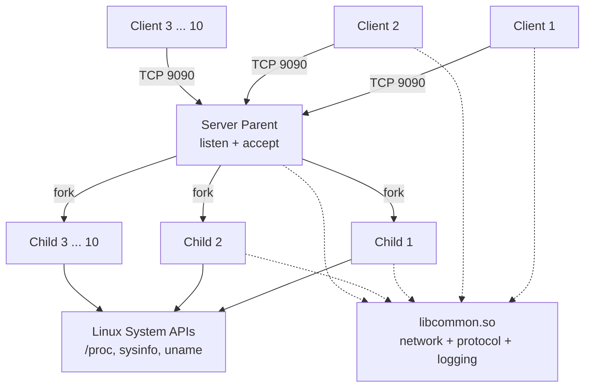

# Linux System Monitor — Client–Server 專案規格書（SPEC）

| 欄位 | 內容 |
| --- | --- |
| 文件版本 | v1.0 |
| 專案名稱 | Linux System Monitor（Linux 系統資訊監控伺服器） |
| 專案類型 | C / Linux / TCP Socket / Multi-process |
| 文件用途 | 期中專案開發、測試、驗收與報告依據 |
| 開發環境 | Ubuntu Linux（實體機、VM 或 WSL2）；GCC、GNU Make、tcpdump |
| 基本原則 | Server 以 `fork()` 建立每個連線的子行程；**不得使用 threads** |

---

## 1. 專案概述

### 1.1 目標

使用 **C 語言**開發一套 TCP Client–Server 應用程式。Client 能連接 Server 並查詢其系統資訊（CPU、記憶體、系統運行時間、主機與作業系統資訊）。Server 必須為每一個 Client 連線建立獨立的 **child process**，支援至少 **10 個同時連線**，具備可切換的 Debug Log、雙端共用的 **`.so` 動態函式庫**，並能處理常見網路與程序異常。

本專案以容易測試與展示為優先；不需要建立網頁前端、資料庫或多執行緒架構。

### 1.2 使用情境

1. 使用者啟動 Server，監聽 `127.0.0.1:9090`。
2. 使用者啟動一個或多個 Client，連線至 Server。
3. Client 發送 `GET ALL`、`GET CPU` 等指令。
4. Server 以獨立子行程取得系統資訊並回傳結果。
5. 使用者可同時啟動 10 個 Client，觀察 child PIDs，並透過 tcpdump 分析 TCP 封包。

### 1.3 範圍與非目標

**必要範圍**：TCP Socket、`fork()` 多程序處理、系統資訊查詢、共享函式庫、兩階段 Debug Log、異常處理、Makefile、封包分析、10 Client 並行測試、三組異常處理對照實驗。

**非目標（MVP 不做）**：GUI、HTTP/REST API、資料庫、登入認證、雲端部署、跨平台 Windows 原生支援、thread pool、TLS 加密。此專案採用**明文 TCP 自訂文字協定**，預設只監聽本機 Loopback；不要直接對公網開放。

---

## 2. 功能需求（Functional Requirements）

| ID | 優先級 | 功能 | 規格 | 驗收方式 |
| --- | --- | --- | --- | --- |
| FR-01 | 必要 | TCP Server | 使用 `socket()`、`bind()`、`listen()`、`accept()` 監聽連線 | Client 能成功建立 TCP 連線 |
| FR-02 | 必要 | TCP Client | 使用 `connect()` 連線，送出命令並顯示回應 | Client 終端機能看到正確資料 |
| FR-03 | 必要 | 每連線一個子行程 | Parent 在 `accept()` 後呼叫 `fork()`；child 處理該連線；**禁止 threads** | Server 日誌與 `ps` 顯示多個不同 PID |
| FR-04 | 必要 | 10 Client 並行 | 至少 10 個同時存在且被處理的 Client 連線 | 自動化測試 + PID/時間戳證據 |
| FR-05 | 必要 | 查詢系統資訊 | `GET ALL` 回傳 CPU、Memory、Uptime、Hostname、OS | 回傳資料與 Linux 系統值合理一致 |
| FR-06 | 必要 | 個別查詢 | `GET CPU`、`GET MEMORY`、`GET UPTIME`、`GET HOSTNAME` | 每種命令有可解析回應 |
| FR-07 | 必要 | 連線健康檢查 | `PING` 回傳 `OK pong=1` | 收到預期回覆 |
| FR-08 | 必要 | 連線結束 | `QUIT` 正常關閉 Client 連線 | Client/Child 不再占用連線資源 |
| FR-09 | 必要 | Compile-time Debug | 透過 `make DEBUG=1` 編入 Debug Log；`DEBUG=0` 不編入 | 同一操作兩種 build 的 Debug 行為不同 |
| FR-10 | 必要 | Runtime Debug | 啟用編譯 Debug 時，以 `server --debug` / `client --debug` 控制顯示 | 不加 `--debug` 時不顯示 DEBUG 訊息 |
| FR-11 | 必要 | 動態共用函式庫 | 共用網路與 Logging 工具函式建置為 `libcommon.so` | `ldd` 顯示 Client、Server 均連結該 `.so` |
| FR-12 | 必要 | 封包擷取與分析 | tcpdump 擷取 Loopback TCP 交通，輸出 `.pcap` | 可觀察握手、請求、回應、斷線 |
| FR-13 | 必要 | Robustness | 正確處理錯誤命令、斷線、逾時、資源釋放、`fork()` 失敗、殭屍程序等 | 異常時 Server 不因單一 Client 失效 |
| FR-14 | 必要 | 三組前後對照 | 提供 baseline 與 robust 兩個可重現的建置模式，執行三組相同測試 | 截圖與紀錄明確呈現差異 |
| FR-15 | 必要 | Makefile 建置 | 一個 `make` 指令能編譯 `.so`、Client、Server | `make clean && make` 成功 |
| FR-16 | 展示 | 受控延遲測試 | `--demo` 模式允許 `DEMO WAIT N`（N=1～5 秒）以展示真實並行處理 | 10 個 Client 可在相近的時間窗進行 WAIT |

> FR-16 是為了**清楚證明同時處理**而設計的測試輔助功能，僅在本機展示模式啟用，不屬於公開服務功能。

---

## 3. 非功能需求（Non-Functional Requirements）

| ID | 需求 | 預設設計與限制 |
| --- | --- | --- |
| NFR-01 | 作業系統 | Linux / POSIX API（Ubuntu、WSL2 Ubuntu） |
| NFR-02 | 語言 / 編譯器 | C11；GCC；建議 `-std=c11 -Wall -Wextra -Werror`（依實作處理系統 feature macros） |
| NFR-03 | 併發能力 | 支援至少 10 個並行 Client；設計上限 `MAX_CLIENTS=64`，防止無限制 `fork()` |
| NFR-04 | 預設網路設定 | `127.0.0.1:9090`；可透過 CLI 設定 Host/Port |
| NFR-05 | 傳輸協定 | TCP；UTF-8/ASCII 可讀指令；單行 Request/Response |
| NFR-06 | 請求上限 | 單一請求最多 256 Bytes（包含結尾 LF）；超出即拒絕並關閉該連線 |
| NFR-07 | 回應上限 | 單一回應最多 2048 Bytes（包含結尾 LF）；不足時回傳內部錯誤，不進行不安全截斷 |
| NFR-08 | 逾時 | 完整一行請求期限 5 秒；無新請求的閒置連線可設定 10 秒清理；寫入亦有截止期限 |
| NFR-09 | 資源回收 | 不留下長期 Zombie Process；所有 Child/Parent Socket 在適當時機關閉 |
| NFR-10 | 記錄可追蹤性 | Log 含時間、Level、PID 與事件內容，便於對應 10 Client 測試 |
| NFR-11 | 可重現性 | `make` / `make baseline` / `make DEBUG=1` 有明確產物與執行指令 |

**逾時語意：** 完整讀取一行的 5 秒為「總截止期限」（以 `CLOCK_MONOTONIC` 搭配 `poll()`／剩餘時間判斷），不能只靠每次 `recv()` 的 socket timeout，否則惡意客戶端可每隔幾秒送 1 個 Byte 無限占用 child。閒置超時指上一個完整命令處理完成後，等待下一個命令的最長時間；可用一致的 deadline 機制實作。

---

## 4. 系統架構（Architecture）

### 4.1 高階元件圖



### 4.2 Server 職責

**Parent Process（主行程）**

1. 解析參數（Host、Port、`--debug`、`--demo`）。
2. 初始化 Logger 與 Socket，設定 `SO_REUSEADDR`。
3. `bind()`、`listen()`，安裝 `SIGCHLD` / `SIGINT` / `SIGTERM` / `SIGPIPE` 處理機制。
4. 持續呼叫 `accept()`；每收到一個 Client，檢查負載並 `fork()`。
5. `fork()` 成功後：**Parent 關閉該 Client 的 accepted socket**，繼續等待新連線。
6. 回收已退出子行程；維護子行程數量，上限預設 64。

**Child Process（子行程）**

1. 繼承 accepted socket，立即**關閉 listen socket**。
2. 設定超時／錯誤處理；記錄 Child PID 與 Client 連線資訊。
3. 在同一 TCP 連線上依序讀取多個命令，進行解析和處理。
4. 呼叫系統資訊模組，透過 `libcommon.so` 傳送回應。
5. 遇 `QUIT`、EOF、逾時或嚴重傳輸錯誤後關閉 Client Socket，以 `_exit()` 結束。

### 4.3 `fork()` 與檔案描述符生命週期

```text
Server Parent
  └─ listen_fd = socket() -> bind() -> listen()
       └─ client_fd = accept()
            └─ fork()
                 ├─ Parent：close(client_fd)；回到 accept()
                 └─ Child ：close(listen_fd)
                              └─ read command -> send response
                                  └─ close(client_fd) -> _exit()
```

> **重要：** 如果 Parent 忘記關閉 `client_fd`，TCP 連線可能無法按預期完全結束；如果 Child 忘記關閉 `listen_fd`，會不必要地持有監聽描述符。`fork()` 失敗必須檢查 `pid < 0`，不能誤走 Child 分支。

### 4.4 模組邊界

| 模組 | 擁有責任 | 不應負責 |
| --- | --- | --- |
| `server.c` | 監聽、fork、Signal、Child 生命周期、CLI | 實作 Client 的 CLI |
| `request_handler.c` | 解析 Client 指令、檢查合法性、派送 Handler、組裝回應 | 直接管理 Parent `accept()` |
| `system_info.c` | 讀取 `/proc`、`sysinfo()`、`uname()`、`gethostname()` 等 | 處理 Socket accept/fork |
| `client.c` | 連線、輸入命令、展示回應、測試參數 | 直接讀 Server 的 `/proc` |
| `common/net.c` | Socket 可靠讀寫、line framing、timeout、部分傳輸處理 | 業務指令的語意 |
| `common/log.c` | Logger、時間與 PID、Debug control | 系統資訊查詢 |
| `common/protocol.c` | 共用字串／回應格式工具、通訊協定常數 | 單側專有的系統資訊取得 |

---

## 5. 通訊協定設計（TCP Application Protocol）

### 5.1 連線模式與訊息界定

- 採 **持久 TCP 連線**：一個 Client 可以先 `PING`，再 `GET ALL`，最後 `QUIT`。
- **一行一個完整命令／回應**，以 `\n`（LF）結束；Client 可接受輸入中有 `\r\n`，Server 對尾端 `\r` 做明確去除。
- TCP 是 Byte Stream，不能假設一次 `recv()` 就會得到一整行，也不能假設一次 `send()` 就把整筆資料送完。
- 所有指令關鍵字以 ASCII 大寫。額外參數依命令規格解析；錯誤指令回傳標準錯誤格式。
- 單行長度上限見 NFR-06/07；包含終止換行符，但不包含 C 字串終止 `\0`。

### 5.2 Client 支援命令

| 命令 | 行為 | Response 範例 |
| --- | --- | --- |
| `PING` | 連線健康檢查 | `OK pong=1` |
| `GET ALL` | 所有指定系統資訊 | `OK hostname=demo os=Linux kernel=6.8.0 cpu_cores=8 cpu_usage_pct=12.5 mem_total_kb=16384000 mem_available_kb=8192000 uptime_sec=3600` |
| `GET CPU` | 邏輯核心數和 CPU 使用率 | `OK cpu_cores=8 cpu_usage_pct=12.5` |
| `GET MEMORY` | 總量及可用記憶體（KB） | `OK mem_total_kb=16384000 mem_available_kb=8192000` |
| `GET UPTIME` | 系統開機至今秒數 | `OK uptime_sec=3600` |
| `GET HOSTNAME` | 主機名稱 | `OK hostname=demo` |
| `QUIT` | 回應後關閉連線 | `OK bye=1` |
| `DEMO WAIT 3` | **僅 Server 啟用 `--demo` 時**，讓 Child 等待 3 秒再回應 | `OK waited_sec=3` |

**CPU 使用率計算：** 讀取 `/proc/stat` 的累積 CPU 時間計數，間隔約 200–250 ms 再讀一次，以 `(Δtotal - Δidle) / Δtotal × 100%` 算出整體使用率；若採此方式，須處理 `Δtotal == 0` 和檔案讀取失敗。

**記憶體：** 從 `/proc/meminfo` 取 `MemTotal` 與 `MemAvailable`；**Uptime：** 取 `/proc/uptime` 或 `sysinfo().uptime`；**OS：** 使用 `uname()`。欄位數值依真實量測而定，範例只是示意。

### 5.3 回應格式

- 成功：`OK key=value key=value ...\n`
- 失敗：`ERR code=ERROR_CODE detail=SHORT_TOKEN\n`
- `key` 使用固定英文小寫加底線；value 不包含空白或換行，必要時轉義／正規化。
- 欄位名稱、單位與錯誤碼要固定，不因 Debug Mode 改變。

| 錯誤碼 | 觸發條件 | Server 行為 |
| --- | --- | --- |
| `BAD_COMMAND` | 未知指令 | 回應錯誤；保留連線以接受下一個命令 |
| `INVALID_ARGUMENT` | 缺少參數、數字格式或值不合法 | 回應錯誤；保留連線 |
| `REQUEST_TOO_LONG` | 請求超過 256 Bytes | 回應錯誤後關閉連線，避免殘餘資料變成新指令 |
| `TIMEOUT` | 完整命令逾時或閒置連線逾時 | 盡可能回應錯誤，然後關閉連線 |
| `INTERNAL_ERROR` | 系統資訊無法取得等內部錯誤 | 記錄 ERROR，回應錯誤；視情況保留或關閉連線 |
| `SERVER_BUSY` | 已達子行程上限 | 拒絕新連線並盡可能回應錯誤 |
| `DEMO_DISABLED` | 未開啟 `--demo` 卻使用測試指令 | 回應錯誤；保留連線 |

---

## 6. Debug Logging 規格

### 6.1 二階段控制

| Compile-time | Runtime | DEBUG 是否顯示 |
| --- | --- | --- |
| `DEBUG=0` | 無 `--debug` | 否 |
| `DEBUG=0` | 有 `--debug` | **否**（程式未編入 Debug 訊息） |
| `DEBUG=1` | 無 `--debug` | 否 |
| `DEBUG=1` | 有 `--debug` | **是** |

- `ERROR` / `INFO` 為必要的操作或錯誤紀錄，與 DEBUG 啟用與否獨立。
- 編譯階段使用 `-DENABLE_DEBUG_LOG=1` 加上 `#if` / 巨集，確保 DEBUG 訊息在未啟用時不編入。
- 執行階段使用 `--debug`；只在已編入 DEBUG 的版本中生效。

### 6.2 Log 格式與內容

```text
[2026-11-08 15:20:00] [INFO]  [pid=1201] server listening addr=127.0.0.1:9090
[2026-11-08 15:20:01] [DEBUG] [pid=1201] accepted client fd=4
[2026-11-08 15:20:01] [INFO]  [pid=1205] child started
[2026-11-08 15:20:01] [DEBUG] [pid=1205] request=GET_CPU
[2026-11-08 15:20:01] [INFO]  [pid=1205] child exited
```

記錄網路操作的成敗與 PID，但不把任意長度的 Client 原始資料直接寫入 Log；應限制長度並處理控制字元，避免 Log Injection。

---

## 7. 動態共享函式庫（libcommon.so）

### 7.1 必要共用 API（可微調命名）

```c
// common.h / net.h（介面草案）
int net_readline(int fd, char *buf, size_t cap, int deadline_ms);
int net_write_all(int fd, const void *buf, size_t len, int deadline_ms);
int net_connect(const char *host, unsigned short port);
void log_init(int runtime_debug_enabled);
void log_message(int level, const char *fmt, ...);
```

**契約要求：** 每個函式需在 Header 清楚定義成功／失敗的回傳值與 `errno` 使用方式；`net_readline()` 必須區分正常 EOF、超時、輸入過長、系統錯誤，避免 Caller 混淆。Client、Server 都必須**實際呼叫**共用 API，不能只是將 `.so` 放在資料夾中卻未使用。

### 7.2 動態連結方式

- 編譯共享程式碼使用 `-fPIC`，連結共享函式庫使用 `-shared`。
- 產出 `build/lib/libcommon.so`；Client 與 Server 使用 `-Lbuild/lib -lcommon` 連結。
- 為了在不同工作目錄都可啟動，設定執行檔 **RUNPATH** 指向 `$ORIGIN/../lib`（Makefile 引號與 `$` 轉義要正確），或在 README 明確說明 `LD_LIBRARY_PATH`。
- 使用 `ldd build/bin/server` 與 `ldd build/bin/client` 驗證兩端都解析到同一 `libcommon.so`。

---

## 8. Robustness（異常處理）設計

| ID | 異常 | 偵測方式 | 必須採取的行為 |
| --- | --- | --- | --- |
| RB-01 | Client 傳送不合法命令 | 指令解析失敗 | 回傳 `ERR code=BAD_COMMAND`，不讓 Server 崩潰 |
| RB-02 | 資料長度超限 | `net_readline()` 偵測上限 | 回傳 `REQUEST_TOO_LONG` 並關閉該連線 |
| RB-03 | Client 不送完整命令／閒置 | monotonic deadline 過期 | 超時後關閉 Client FD，Child 結束 |
| RB-04 | Client 在接收中突然離線 | `recv() == 0` 或 socket error | 正確結束當前 Child，不影響 Parent |
| RB-05 | Client 在 Server `send()` 時斷線 | `EPIPE`、`ECONNRESET` 等 | 防止 `SIGPIPE` 終止程序；寫入錯誤後釋放連線 |
| RB-06 | `send()` / `recv()` 短傳輸、`EINTR` | 檢查回傳長度與 errno | 迴圈直到完整收發或確定失敗 |
| RB-07 | `fork()` 失敗 | 回傳 PID `< 0` | Parent 記錄原因、關閉當前連線，繼續服務其他 Client |
| RB-08 | Child 結束形成 Zombie | `SIGCHLD` + `waitpid(..., WNOHANG)` | 回收 Child，確保長時間運作沒有殭屍程序堆積 |
| RB-09 | 同時連線過多 | Active Child 計數達 64 | 拒絕額外連線；限制資源消耗 |
| RB-10 | 系統資訊讀取失敗 | 檢查 `/proc`、`uname()` 等結果 | 回傳 `INTERNAL_ERROR`、記錄原因，不輸出未初始化資料 |
| RB-11 | Server 被要求停止 | `SIGINT` / `SIGTERM` | 停止 accept，釋放資源，處理子行程退出與回收 |

**Signal 與併發設計注意事項：**

- 對 `SIGPIPE` 採 `sigaction(SIGPIPE, SIG_IGN, ...)`，搭配 `send()` 的錯誤回傳檢查；或使用 `MSG_NOSIGNAL`。
- `SIGCHLD` handler 只做 async-signal-safe 的動作（例如 `waitpid()`、設定 `sig_atomic_t` 旗標），**不要在 handler 中使用 `printf()`／一般 Logger**。
- 若用 `active_children` 計數，Parent 必須在 `fork()` 與更新數量的關鍵區間遮蔽 `SIGCHLD`（`sigprocmask()`），避免 Child 先退出，計數出現競態。
- Parent 的 `accept()` 若因 Signal 中斷而回傳 `EINTR`，應重試而不是直接結束服務。
- 子行程應避免在正常結束路徑留下開啟中的 Socket；錯誤路徑也要有一致 Cleanup。

---

## 9. 專案目錄結構

```text
linux-system-monitor/
├── Makefile
├── README.md
├── SPEC.md                       # 本文件
├── include/
│   ├── common.h
│   ├── net.h
│   ├── protocol.h
│   ├── logger.h
│   └── system_info.h
├── src/
│   ├── common/
│   │   ├── net.c
│   │   ├── protocol.c
│   │   └── logger.c
│   ├── server/
│   │   ├── server.c
│   │   ├── request_handler.c
│   │   └── system_info.c
│   └── client/
│       └── client.c
├── tests/
│   ├── concurrent_10.sh
│   ├── test_robustness.sh
│   └── test_protocol.sh
├── captures/
│   └── loopback.pcap              # 測試後產生
├── docs/
│   ├── REPORT.md
│   └── screenshots/
└── build/                        # make 產生；不進版控
    ├── bin/
    │   ├── server
    │   └── client
    ├── lib/
    │   └── libcommon.so
    └── baseline/                  # make baseline 產生
        ├── bin/
        └── lib/
```

注意：Header 是供多模組引用；**不能因為 Header 共用就認為符合 `.so` 要求**，仍須產生、動態連結並實際使用 `.so`。

---

## 10. CLI 與建置介面

### 10.1 Makefile Targets

| 指令 | 預期效果 |
| --- | --- |
| `make` | 建立 robust 的 Server、Client、`libcommon.so`（預設 `DEBUG=0`） |
| `make DEBUG=1` | 建立有編入 DEBUG 的版本 |
| `make clean && make DEBUG=0` | 確保乾淨建置且 DEBUG 真的未編入 |
| `make baseline` | 建立**教學實驗專用**的無防護 baseline 版本（使用獨立目錄，不覆蓋正式版） |
| `make test` | 執行協定功能測試（可含多 Client 測試） |
| `make clean` | 清除編譯產物 |

**注意：** 不同 `DEBUG` 值若重用相同物件檔，Make 不一定會自動重編譯。Makefile 應用獨立 Build Directory（例如 `build/debug` / `build/release`），或要求先 `make clean`，並在 README 說明。

### 10.2 執行範例

```bash
# Server
./build/bin/server --host 127.0.0.1 --port 9090 --debug --demo

# Client：執行一次命令
./build/bin/client --host 127.0.0.1 --port 9090 --command "GET ALL"

# Client：互動模式（沒有 --command）
./build/bin/client --host 127.0.0.1 --port 9090

# 並行展示：收到回應後持續保持連線 5 秒
./build/bin/client --command "GET ALL" --hold 5

# 異常測試：建立連線後不傳資料 15 秒（僅測試用途）
./build/bin/client --idle 15
```

`--hold` 讓 Client 在收到回覆後再延遲關閉 Socket；Server Child 仍在等待同一 TCP 連線上的下一個命令。`--idle` 則建立連線但不送任何指令，專門測試逾時清理。CLI 需要對互斥參數組合進行驗證。

---

## 11. 測試計畫與驗收證據

### 11.1 基本功能測試

| Test ID | 測試內容 | 通過條件 |
| --- | --- | --- |
| TC-01 | Server 啟動與 `PING` | Client 收到 `OK pong=1` |
| TC-02 | `GET ALL` | 有完整 hostname、OS、kernel、CPU、memory、uptime 欄位 |
| TC-03 | 各別系統查詢 | 各指令回應資料型別／單位正確 |
| TC-04 | 同一連線連續下 3 個命令 | Server 能逐次回覆，資料不混淆 |
| TC-05 | `QUIT` | Server 收到後結束該 Client Child |
| TC-06 | `.so` | `ldd` 明確顯示兩個執行檔連到 `libcommon.so` |
| TC-07 | DEBUG 四種組合 | 與第 6.1 節矩陣一致 |
| TC-08 | TCP 封包 | `.pcap` 能看到三向交握、指令、回覆、FIN／RST 等實際流程 |

### 11.2 同時 10 Client 測試（必做）

啟動 Server 時加 `--demo --debug`（需先 `make DEBUG=1`）：

```bash
./build/bin/server --host 127.0.0.1 --port 9090 --debug --demo
```

開啟另一個 Terminal，讓 10 個 Client **同時**送出需要等待 3 秒的請求：

```bash
for i in $(seq 1 10); do
  ./build/bin/client --port 9090 --command "DEMO WAIT 3" &
done
wait
```

**應提供三類證據：**

1. 10 個 Client 全部收到 `OK waited_sec=3`，沒有連線失敗或錯誤回應。
2. 在三秒內使用 `ps -o pid,ppid,stat,cmd --ppid <SERVER_PID>`，看到**至少 10 個 Server child** 同時存在；Server Log 顯示 10 個 Child PID。
3. 同時處理的總耗時應明顯接近單次 3 秒加上啟動額外開銷，而不是依序處理的約 30 秒；時間作為輔助證據，不以絕對秒數單獨判定通過。

**避免誤判：** 單純連續跑 10 次成功不代表「同時處理」。需有時間重疊或同時存活的 PID 證據。正式測試腳本 `tests/concurrent_10.sh` 應將啟動、回覆、PID 證據存成文字紀錄。

### 11.3 tcpdump 封包擷取（必做）

```bash
mkdir -p captures
sudo tcpdump -i lo -nn -s 0 -w captures/loopback.pcap 'tcp port 9090'

# 在另一個 Terminal 執行 Client
./build/bin/client --port 9090 --command "GET ALL"

# 或直接在 Terminal 觀察 ASCII Payload
sudo tcpdump -i lo -nn -A 'tcp port 9090'
```

報告應至少說明：

- 三向交握 `SYN → SYN,ACK → ACK`。
- `GET ALL\n` 的 Request Payload 與 `OK ...\n` 的 Response Payload。
- TCP Sequence / ACK 的基本意義、實際來源／目的 IP、Port。
- 連線如何關閉（正常 FIN 流程或異常 RST）；分析**實際捕獲的封包**，不能只憑教科書預設每個封包一定長什麼樣。

---

## 12. 三組 Robustness 對照實驗（必做）

為滿足「**with and without robustness mechanisms**」，規定 `make baseline` 產出**受控且僅用於本機比較**的 baseline 執行檔，並由 `make` 產出 robust 執行檔。兩種模式對同樣的輸入執行測試、保留 Server/Client 日誌與截圖。不要以未實測的推測代替證據。

| Case | 操作方式 | Baseline（預期弱點，需實測） | Robust（驗收標準） |
| --- | --- | --- | --- |
| RB-DEMO-01：未知命令 | Client 發 `GET UNKNOWN`，再發 `PING` | Baseline 不做正規指令驗證，可能直接關閉連線或沒有可辨識錯誤訊息 | 回 `ERR code=BAD_COMMAND`，同一連線之後 `PING` 仍成功 |
| RB-DEMO-02：Client 長時間不送指令 | Client `--idle 15`，觀察 Child | Baseline 無請求期限／閒置期限，Child 持續阻塞等候（須手動清除） | Child 在規定期限內因 Timeout 結束並關閉 Socket；Parent 繼續正常服務 |
| RB-DEMO-03：Zombie Process | 連續建立並關閉 10 個 Client，使用 `ps` 查看 Parent 的子行程狀態 | Baseline 不呼叫 `waitpid()`，可觀察 `Z` 狀態的 Zombie 子行程 | Child 正常結束後被 Parent 回收；不持續累積 Zombie |

**Baseline 的設計原則：** `BASELINE_MODE=1` 只在可控制的實驗環境關閉上述**指定防護**，不要任意產生記憶體不安全的程式碼，也不要將 baseline 服務部署到外網。可將三種開關拆開，使每組實驗只比較一項機制的差異。其他必要檢查（例如記憶體邊界）不應為了展示而故意破壞。

**選做第四組：** Client 在 Server 傳送資料期間突然斷線；比較未防護的 Child 可能遭受 `SIGPIPE` 終止與防護版透過 `EPIPE` 記錄錯誤後乾淨退出。須使用受控時序重現，不能保證每次都觸發相同 Kernel 行為。

---

## 13. 源碼核心流程（Pseudo Code）

### 13.1 Server Parent

```text
parse_args()
init_logger()
setup_signal_handlers()
listen_fd = create_bind_listen_socket()

while not_shutdown:
    client_fd = accept(listen_fd)
    if accept interrupted by signal: continue
    if accept failed: log error; continue or backoff
    if active_children >= MAX_CLIENTS:
        best_effort_reply_server_busy(); close(client_fd); continue

    block(SIGCHLD)
    pid = fork()
    if pid < 0:
        unblock(SIGCHLD); close(client_fd); log error; continue
    if pid == 0:
        restore_child_signal_mask_and_handlers()
        close(listen_fd)
        serve_client(client_fd)
        close(client_fd)
        _exit(0)
    else:
        record_child(pid)
        close(client_fd)
        unblock(SIGCHLD)

shutdown_and_reap_children()
```

### 13.2 Child Handler

```text
while connection_is_open:
    request = net_readline(client_fd, limit=256, deadline=5s / idle=10s)
    if EOF: break
    if timeout / too-long: best_effort_error_response(); break
    if read error: log error; break

    if request == QUIT:
        send("OK bye=1\n"); break
    else:
        response = dispatch_request(request)
        if net_write_all(client_fd, response) fails: break

close(client_fd)
exit_child()
```

---

## 14. 建議開發順序（Milestones）

| 階段 | 交付內容 | Done 的標準 |
| --- | --- | --- |
| M1：單 Client | 最小 TCP Server/Client + `PING` | 一來一回、正常關閉 |
| M2：多程序 | Server `fork()`、Parent/Child FD close | 多 Client 可同時處理且 PID 不同 |
| M3：系統資訊 | `GET CPU/MEMORY/UPTIME/HOSTNAME/ALL` | 命令與欄位符合協定 |
| M4：`.so` + Logging | 共用函式庫 + 二階段 DEBUG + Makefile | `ldd` 與 Debug 矩陣全部通過 |
| M5：Robustness | Timeout、合法性檢查、子行程回收等 | 三組對照測試通過 |
| M6：驗證與交付 | 10 Client 測試、pcap、截圖、報告、影片 | 所有 Required Evidence 齊全 |

---

## 15. 提交內容與驗收檢查表

- [ ] 完整 C 原始碼與 Header（Client / Server / Common / System Info）
- [ ] Makefile；`make`、`make clean`、`make DEBUG=1`、`make baseline` 皆可執行
- [ ] `libcommon.so`；`ldd` 證明 Client/Server 都動態連結
- [ ] `fork()` Child-per-connection 程序設計與 PID 證據
- [ ] 至少 10 Client 並行的自動測試結果與執行畫面
- [ ] `tcpdump`/Wireshark `.pcap` 與實際封包分析
- [ ] Compile-time / Runtime Debug 四種組合的實驗結果
- [ ] 系統資訊查詢成功截圖與協定說明
- [ ] 三組 Baseline vs Robust 對照測試結果和畫面
- [ ] 報告包含 System Design、Key Code、Screenshots、Complete Source Code
- [ ] （Plus）約 2 分鐘示範影片；是否必繳需向教師確認

### 15.1 建議報告章節

1. Abstract & Project Goal
2. Architecture & Process Model（含 Parent/Child 和模組架構圖）
3. Protocol Design（命令、回應與封包格式）
4. Implementation（Socket、fork、`.so`、Debug、System Info）
5. Concurrency Demonstration（10 Client + PID / 時間證據）
6. Robustness Design & 3 Comparative Experiments
7. Packet Capture & TCP Analysis
8. Conclusion & Limitations
9. Appendix：Build Guide、完整原始碼／Git Repository、截圖索引

### 15.2 2 分鐘影片建議分鏡（選做）

| 時間 | 展示內容 |
| --- | --- |
| 00:00–00:20 | 說明專案架構與 Server 啟動 |
| 00:20–00:40 | Client 查詢 `GET ALL`，顯示系統資訊 |
| 00:40–01:05 | 同時啟動 10 Clients，展示 PID 與成功結果 |
| 01:05–01:25 | 展示 `.so` 的 `ldd` 和 Debug 開關 |
| 01:25–01:45 | 展示三種 Robustness 對照的重點結果 |
| 01:45–02:00 | tcpdump/Wireshark 封包與結論 |

---

## 16. 關鍵設計決策（ADR 摘要）

| Decision | 選擇 | 原因 |
| --- | --- | --- |
| ADR-01 | TCP，不使用 UDP | 面向連線、易展示握手與可靠傳輸；符合 Client–Server 示範 |
| ADR-02 | `fork()` per connection | 作業硬性要求；讓每個 Client 由獨立 PID 隔離 |
| ADR-03 | ASCII 單行協定 | C 實作容易、`tcpdump -A` 可直接檢視、不依賴 JSON Library |
| ADR-04 | `libcommon.so` 負責通訊與 Logging | Client/Server 共用，符合動態連結要求 |
| ADR-05 | Build-time + Runtime Debug 雙重開關 | 符合作業雙層控制要求，且能驗證四種組合 |
| ADR-06 | Baseline 獨立產物 | 可重現有無防護差異，不污染正式 robust 版本 |
| ADR-07 | 預設綁定 Loopback | 無登入與 TLS 的課堂展示程式不適合直接對外公開 |

## 17. 風險與限制

1. **WSL2 的跨主機連線**：如果展示不同電腦通訊，需額外處理 WSL2 網路與 Windows Firewall；同機測試建議先用 Loopback。
2. **Debug 編譯快取**：切換 `DEBUG` 後需確保 `.so` 與所有 Binary 一起重建，否則實驗結果可能被舊物件檔干擾。
3. **量測誤差**：CPU 使用率是採樣區間估計值，不是瞬時真值；不同工具與採樣時段會有小差異。
4. **`fork()` 的系統負擔**：在大量連線下每連線一子行程成本較高；本專案以課堂驗收（至少 10 個同時 Client）為目標，不宣稱可做高併發生產服務。
5. **Plaintext Protocol**：缺少身分驗證與加密，因此預設限制在 localhost / 受信任測試網路。

---

**驗收完成定義（Definition of Done）：** 所有必要 FR、NFR 相關測試、10 Client 並行證據、3 組 Robustness 對照與 TCP `.pcap` 分析均完成，且報告可從乾淨 Linux 環境依 README 重現編譯、啟動與測試過程。
