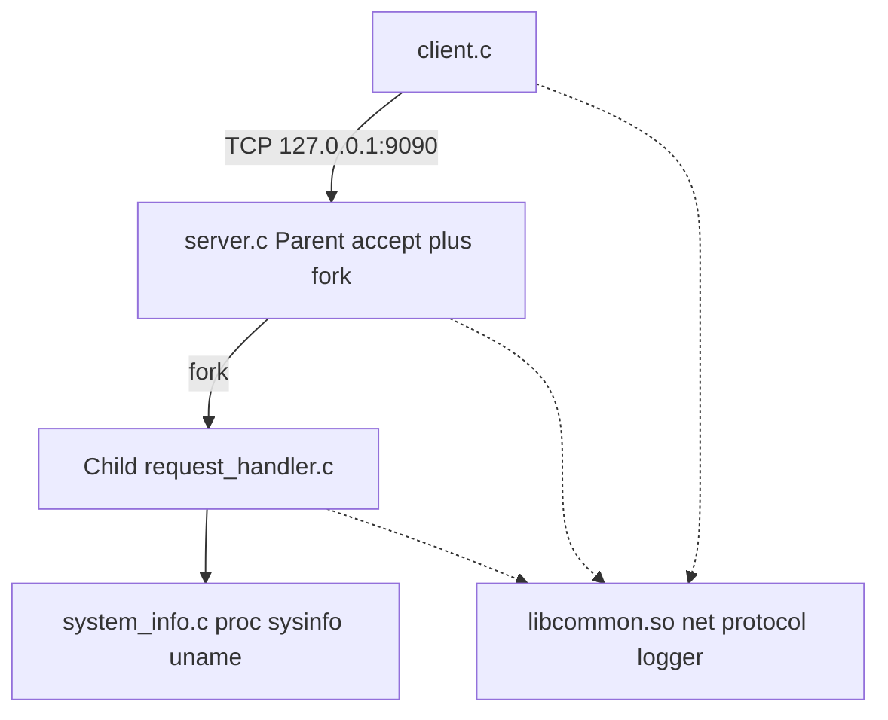

# Linux System Monitor — 實作報告

測試環境：VMware Ubuntu 18.04.6 LTS，kernel `5.4.0-150-generic`，GCC 7.5，x86_64。
測試日期：2026-11-08。完整規格見 [`SPEC.md`](../SPEC.md)。

---

## 1. Abstract & Project Goal

本專案以 C11 實作一套本機 TCP Client–Server 系統監控程式。Client 連上 Server 後可查詢 CPU、記憶體、uptime、主機與作業系統資訊。Server **禁止 threads**，每個連線由 Parent `accept()` 後 `fork()` 一個獨立 Child 處理，至少支援 10 個同時連線（設計上限 `MAX_CLIENTS=64`）。網路讀寫、協定格式與 Logger 抽成 `libcommon.so`，Client 與 Server 皆動態連結並實際呼叫。Debug 採編譯期 (`-DENABLE_DEBUG_LOG`) 與執行期 (`--debug`) 兩階段控制。另提供 `make baseline` 關閉三項指定防護，供對照實驗。

預設只監聽 `127.0.0.1:9090` 明文 TCP，不做 GUI、HTTP、TLS 或認證。

---

## 2. Architecture & Process Model



**Parent**：解析 `--host/--port/--debug/--demo`、安裝 `SIGPIPE=IGN`、`SIGCHLD`（`waitpid(WNOHANG)` 迴圈，僅 async-signal-safe）、`SIGINT/SIGTERM`；`socket/bind/listen`（`SO_REUSEADDR`）；`accept()` 遇 `EINTR` 重試；達 64 子行程時盡力回 `SERVER_BUSY` 後關閉；`sigprocmask` 遮蔽 `SIGCHLD` 包住 `fork()` 與計數；Parent 關閉 `client_fd`。

**Child**：還原 signal mask、關閉 `listen_fd`、`serve_client()`、關閉 `client_fd`、`_exit()`。

**FD 生命週期**

```text
listen_fd = socket/bind/listen
  client_fd = accept()
    fork()
      Parent: close(client_fd); 回到 accept()
      Child : close(listen_fd); readline/dispatch; close(client_fd); _exit()
```

**模組**

| 路徑 | 責任 |
| --- | --- |
| [`src/server/server.c`](../src/server/server.c) | 監聽、fork、signal、CLI、MAX_CLIENTS |
| [`src/server/request_handler.c`](../src/server/request_handler.c) | 指令解析與派送 |
| [`src/server/system_info.c`](../src/server/system_info.c) | `/proc`、`sysinfo()`、`uname()` |
| [`src/client/client.c`](../src/client/client.c) | 連線、互動 / `--command` / `--hold` / `--idle` |
| [`src/common/net.c`](../src/common/net.c) | `poll()` + `CLOCK_MONOTONIC` 總截止期限 |
| [`src/common/protocol.c`](../src/common/protocol.c) | `OK` / `ERR` 組裝，不截斷 |
| [`src/common/logger.c`](../src/common/logger.c) | 兩階段 DEBUG、sanitize |

---

## 3. Protocol Design

持久 TCP、一行一命令／回應，以 LF 結束（接受 CRLF）。請求上限 256 bytes（含 LF），回應上限 2048 bytes。關鍵字大寫。

| 請求 | 回應 |
| --- | --- |
| `PING` | `OK pong=1` |
| `GET ALL` | `OK hostname=.. os=Linux kernel=.. cpu_cores=N cpu_usage_pct=F mem_total_kb=N mem_available_kb=N uptime_sec=N` |
| `GET CPU` | `OK cpu_cores=N cpu_usage_pct=F`（`/proc/stat` 間隔 200 ms） |
| `GET MEMORY` | `OK mem_total_kb=N mem_available_kb=N` |
| `GET UPTIME` | `OK uptime_sec=N` |
| `GET HOSTNAME` | `OK hostname=NAME` |
| `QUIT` | `OK bye=1` 後關閉 |
| `DEMO WAIT N`（1–5，需 `--demo`） | `OK waited_sec=N` |

錯誤：`ERR code=<CODE> detail=<token>`。碼：`BAD_COMMAND`、`INVALID_ARGUMENT`、`REQUEST_TOO_LONG`（關閉連線）、`TIMEOUT`（關閉）、`INTERNAL_ERROR`、`SERVER_BUSY`、`DEMO_DISABLED`。

實測 `GET ALL`（Ubuntu 18.04 VM）：

```text
OK hostname=ubuntu os=Linux kernel=5.4.0-150-generic cpu_cores=2 cpu_usage_pct=2.6 mem_total_kb=6052956 mem_available_kb=4076984 uptime_sec=60629
```

---

## 4. Implementation

### 4.1 Socket 與超時

`net_readline()` / `net_write_all()` 用 `clock_gettime(CLOCK_MONOTONIC)` 與 `poll()` 計算剩餘時間，避免「每次 `recv()` 各自 timeout」被逐 byte 拖住。回傳碼區分 `NET_OK`、`NET_EOF`、`NET_TIMEOUT`、`NET_TOO_LONG`、`NET_ERROR`。寫入使用 `MSG_NOSIGNAL`。第一個命令 5 s、其後閒置 10 s、寫入 5 s。

### 4.2 fork()

`fork()` 失敗記錄後關閉當前 `client_fd` 繼續服務。Child 不走 Parent 的 `accept()` 迴圈。Parent 維護 `active_children`，與 `SIGCHLD` 更新以 `sigprocmask` 同步。

### 4.3 libcommon.so

`-fPIC -shared` → `build/lib/libcommon.so`。執行檔 `-lcommon` 且 `RUNPATH=$ORIGIN/../lib`。VM 上 `ldd`：

```text
libcommon.so => /home/wei/linux-system-monitor/build/bin/../lib/libcommon.so
```

`readelf -d`：`NEEDED [libcommon.so]`，`RUNPATH [$ORIGIN/../lib]`。完整輸出見 [`evidence/ldd.txt`](evidence/ldd.txt)。

### 4.4 Debug

`LOG_DEBUG(...)` 僅在 `-DENABLE_DEBUG_LOG=1` 展開，否則為 `((void)0)`。執行期 `log_init(--debug)`。格式：

```text
[2026-11-08 16:48:01] [INFO]  [pid=117556] server listening addr=127.0.0.1:9090 ...
[2026-11-08 16:48:01] [INFO]  [pid=117588] child started peer=127.0.0.1:52750 fd=4
```

Client 原始資料經 `log_sanitize()` 限長並把控制字元換成 `.`。

### 4.5 System Info

- CPU：`/proc/stat` 讀兩次，`(Δtotal − Δidle) / Δtotal × 100`，處理 `Δtotal == 0`；核心數 `sysconf(_SC_NPROCESSORS_ONLN)`。忙碌迴圈下約 50%（2 核中 1 核 busy）。
- Memory：`/proc/meminfo` 的 `MemTotal` / `MemAvailable`。
- Uptime：`/proc/uptime`，失敗則 `sysinfo().uptime`。
- Host/OS：`gethostname()` + `uname()`；空白正規化為 `_`。失敗回 `INTERNAL_ERROR`，不輸出未初始化資料。

### 4.6 Makefile

獨立目錄 `build/release`、`build/debug`、`build/baseline`，避免切換 `DEBUG` 重用舊 `.o`。`make` / `make DEBUG=1` 複製到 SPEC 路徑 `build/bin`、`build/lib`。`make baseline` 只寫 `build/baseline/`。

---

## 5. Concurrency Demonstration（10 Client）

指令：`make DEBUG=1` 後 `tests/concurrent_10.sh`（Server `--demo --debug`，10 個 `DEMO WAIT 3` 同時送出）。證據：[`evidence/concurrent_10.log`](evidence/concurrent_10.log)、[`evidence/concurrent_10_ps.txt`](evidence/concurrent_10_ps.txt)。

| 項目 | 結果 |
| --- | --- |
| 10/10 回應 | 皆 `OK waited_sec=3`，exit 0 |
| 同時存活 Child | 啟動後 1 s `ps --ppid 117556` 看到 **10** 個不同 PID |
| Server log | `child started`=10、`child exited`=10 |
| 總耗時 | **3.02 s**（循序約 30 s） |
| 結束後殘留 | 0 |

同時存活 PID（Parent 117556）：`117588 117589 117591 117592 117593 117600 117602 117603 117604 117605`。

這不是「連續跑 10 次成功」：時間重疊與 10 個同時 PID 同時成立。

---

## 6. Robustness Design & 3 Comparative Experiments

Robust：`make`。Baseline：`make baseline`（`-DBASELINE_MODE=1` → `NO_VALIDATE` + `NO_TIMEOUT` + `NO_REAP`）。記憶體邊界檢查兩邊相同。腳本：`tests/test_robustness.sh --mode robust|baseline`。

### RB-DEMO-01 未知命令

| | Robust | Baseline |
| --- | --- | --- |
| `GET UNKNOWN` | `ERR code=BAD_COMMAND detail=unknown_target` | 無錯誤回應，stdout 空 |
| 同一連線 `PING` | `OK pong=1` | 連線被關，Client 記 EOF，PING 無回應 |
| Parent | 存活，新連線仍可 PING | 存活，新連線仍可 PING |

### RB-DEMO-02 閒置 Client（`--idle 15`）

| | Robust | Baseline |
| --- | --- | --- |
| Child | 約 4 s 內因 5 s 首命令期限結束 | 12 s 後仍存活（腳本隨後清理） |
| Client | 收到 `ERR code=TIMEOUT` | 無 TIMEOUT 回應 |
| Parent | 繼續服務新 Client | 繼續服務新 Client |

### RB-DEMO-03 Zombie

連續建立並關閉 10 個 Client 後 `ps`：

| | Robust | Baseline |
| --- | --- | --- |
| Z 狀態 | **0** | **14**（含前面 RB-01/02 殘留，≥ 10） |

Robust 12/12 PASS；Baseline 刻意重現弱點 6/6 PASS。完整 log：[`robustness_robust.log`](evidence/robustness_robust.log)、[`robustness_baseline.log`](evidence/robustness_baseline.log)。

### Debug 四組合（TC-07）

[`debug_matrix.log`](evidence/debug_matrix.log)：18/18 PASS。`strings` 確認 release binary 不含 DEBUG 格式字串。

| Compile | Runtime | `[DEBUG]` |
| --- | --- | --- |
| `DEBUG=0` | 無 `--debug` | 0 |
| `DEBUG=0` | `--debug` | 0（未編入） |
| `DEBUG=1` | 無 `--debug` | 0 |
| `DEBUG=1` | `--debug` | Server 9 行、Client 6 行 |

`INFO` 四種組合皆存在。

---

## 7. Packet Capture & TCP Analysis

檔案：[`captures/loopback.pcap`](../captures/loopback.pcap)（28 packets，0 dropped）。文字：[`pcap_summary.txt`](evidence/pcap_summary.txt)、[`pcap_ascii.txt`](evidence/pcap_ascii.txt)。介面 `lo`，filter `tcp port 9090`。兩條連線皆 `127.0.0.1` → `127.0.0.1:9090`。

### 連線 1：`GET ALL`（client 49676）

| 時間 | Flags | 意義 | 相對 SEQ |
| --- | --- | --- | --- |
| 16:48:41.833575 | `[S]` seq=4216289615 | Client SYN | — |
| 16:48:41.833612 | `[S.]` seq=3969916703 ack=4216289616 | Server SYN-ACK | — |
| 16:48:41.833654 | `[.]` ack=1 | Client ACK，三向交握完成 | — |
| 16:48:41.834050 | `[P.]` seq 1:9 length=8 | Payload `GET ALL\n` | 1–9 |
| 16:48:42.034943 | `[P.]` seq 1:147 length=146 | Payload `OK hostname=ubuntu ... uptime_sec=60674\n` | 1–147 |
| 16:48:42.035189 | `[P.]` seq 9:14 length=5 | Payload `QUIT\n` | 9–14 |
| 16:48:42.035393 | `[P.]` seq 147:156 length=9 | Payload `OK bye=1\n` | 147–156 |
| 16:48:42.035486 | `[F.]` seq=156 | **Server Child 先 FIN**（處理完 QUIT 後關閉） | — |
| 16:48:42.035540 | `[F.]` seq=14 ack=157 | Client FIN | — |
| 16:48:42.035574 | `[.]` ack=15 | Server ACK，四次揮手完成 | — |

回應延遲約 200 ms，對應 CPU 採樣間隔，不是網路 RTT。

SEQ/ACK：Client 送 8 bytes 後 Server ACK=9；Server 送 146 bytes 後 Client ACK=147。相對序號從握手後的 1 起算。

### 連線 2：`PING`（client 49686）

同樣看到 SYN → SYN,ACK → ACK，payload `PING\n` / `OK pong=1\n` / `QUIT\n` / `OK bye=1\n`。此次同樣是 **Server Child 先 FIN**（處理完 `QUIT` 後關閉），Client 隨後送出 FIN，為正常 FIN 流程，**沒有 RST**。

本次擷取的兩條連線都是 Server 先送 FIN。實際順序取決於哪一端先 `close()`，每次執行可能不同，分析以 pcap 為準。

---

## 8. Conclusion & Limitations

必要 FR/NFR 測試、10 Client 並行證據、三組 Robustness 對照、tcpdump `.pcap` 均已在乾淨 Ubuntu 18.04 VM 上重現。`make` / `make DEBUG=1` / `make baseline` 以 `-Werror` 通過。

限制：

1. CPU 使用率是 200 ms 區間估計，閒置時常見 `0.0`。
2. `fork()` per connection 適合課堂驗收（≥10 同時 Client），不是高併發生產架構。
3. 明文協定、無認證，只應綁 loopback。
4. Baseline 僅供本機對照，不可對外。
5. 實機截圖見 [`screenshots/`](screenshots/README.md) 與 [9.5](#95-screenshots)。文字證據在 `docs/evidence/`。2 分鐘示範影片為選做，本次未錄。

從乾淨 Linux 重現：見 [`README.md`](../README.md)（`sudo apt-get install -y build-essential tcpdump` 後 `make && make baseline` 再跑 `tests/`）。

---

## 9. Appendix

### 9.1 Build Guide

```bash
sudo apt-get install -y build-essential tcpdump
make clean && make
make DEBUG=1
make baseline
ldd build/bin/server | grep libcommon
tests/test_protocol.sh
tests/debug_matrix.sh
make                       # 把 build/bin 從 debug 換回 release
tests/concurrent_10.sh
tests/test_robustness.sh --mode robust
tests/test_robustness.sh --mode baseline
sudo -E tests/capture_pcap.sh
```

### 9.2 測試摘要（2026-11-08 16:47–16:48，VM）

| 腳本 | 結果 |
| --- | --- |
| `test_protocol.sh` | PASS=43 FAIL=0 |
| `debug_matrix.sh` | PASS=18 FAIL=0 |
| `concurrent_10.sh` | PASS=5 FAIL=0（3.02 s，10 child PID） |
| `test_robustness.sh --mode robust` | PASS=12 FAIL=0 |
| `test_robustness.sh --mode baseline` | PASS=6 FAIL=0（弱點皆重現） |
| `capture_pcap.sh` | PASS=9 FAIL=0（28 packets） |

### 9.3 原始碼索引

- Headers：[`include/`](../include/)
- Common：[`src/common/`](../src/common/)
- Server：[`src/server/`](../src/server/)
- Client：[`src/client/client.c`](../src/client/client.c)
- Makefile：[`Makefile`](../Makefile)
- Tests：[`tests/`](../tests/)

### 9.4 截圖索引

見 [`screenshots/README.md`](screenshots/README.md) 與 [9.5](#95-screenshots)。對應文字證據：

| 建議截圖 | 文字證據 |
| --- | --- |
| Server 啟動 | `concurrent_10_server.log` |
| GET ALL | `test_protocol.log` |
| 10 Client + ps | `concurrent_10_ps.txt` |
| ldd | `ldd.txt` |
| Debug 矩陣 | `debug_matrix.log` |
| Robust vs Baseline | `robustness_*.log` |
| tcpdump | `pcap_summary.txt`、`loopback.pcap` |

### 9.5 Screenshots

實機畫面（Windows Terminal SSH 進 Ubuntu VM）。檔案在 [`screenshots/`](screenshots/)：

- [`01_server_start.png`](screenshots/01_server_start.png) — `make DEBUG=1` 後 `./build/bin/server --host 127.0.0.1 --port 9090 --debug --demo`，監聽列含 pid 與 `debug_compiled=1`。
- [`02_get_all.png`](screenshots/02_get_all.png) — `GET ALL` 完整 `OK hostname=...`，以及 `GET CPU`、`GET MEMORY`、`PING`。
- [`03_concurrent_10.png`](screenshots/03_concurrent_10.png) — 10 個 `DEMO WAIT 3` 同時執行，`ps --ppid` 看到 10 個 child，`wall_sec=3.035`。
- [`04_ldd.png`](screenshots/04_ldd.png) — `ldd` server/client 都解析到 `libcommon.so`，`readelf` 顯示 `NEEDED` 與 `RUNPATH`。
- [`05_debug_matrix.png`](screenshots/05_debug_matrix.png) — 四種組合結論：只有 DEBUG=1 且 `--debug` 會印出 `[DEBUG]`，`PASS=18 FAIL=0`。
- [`05b_debug_matrix_start.png`](screenshots/05b_debug_matrix_start.png) — `tests/debug_matrix.sh` 開頭，release 建置 `debug_compiled=0` 且 `[DEBUG]` 行數為 0。
- [`06_robust_vs_baseline_01.png`](screenshots/06_robust_vs_baseline_01.png) — 同一連線 `GET UNKNOWN` 再 `PING`：robust 回 `ERR code=BAD_COMMAND` 後仍 `OK pong=1`；baseline 關閉連線、沒有 `BAD_COMMAND`。
- [`07_robust_vs_baseline_02.png`](screenshots/07_robust_vs_baseline_02.png) — idle client：robust child 約 6 秒消失並回 `ERR code=TIMEOUT`；baseline child 到 12 秒仍為 `S`。
- [`08_robust_vs_baseline_03.png`](screenshots/08_robust_vs_baseline_03.png) — 8 次短 `PING` 後 robust `zombies=0`，baseline `STAT` 為 `Z`（10 個）；截圖後已關掉 baseline server。
- [`09_tcpdump.png`](screenshots/09_tcpdump.png) — `sudo -n tcpdump -i lo -nn -A` 看到 `Flags [S]`、`GET ALL`、`OK hostname=`、`Flags [F.]`。
